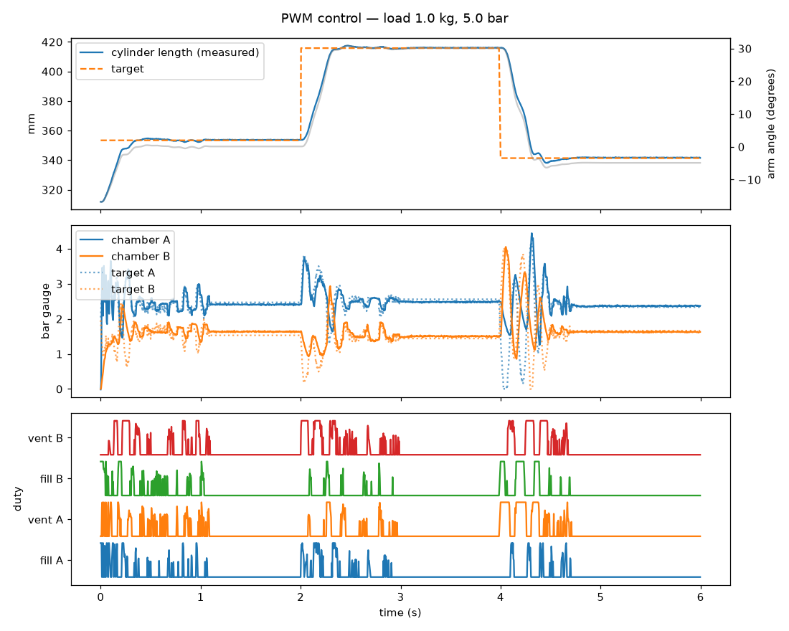
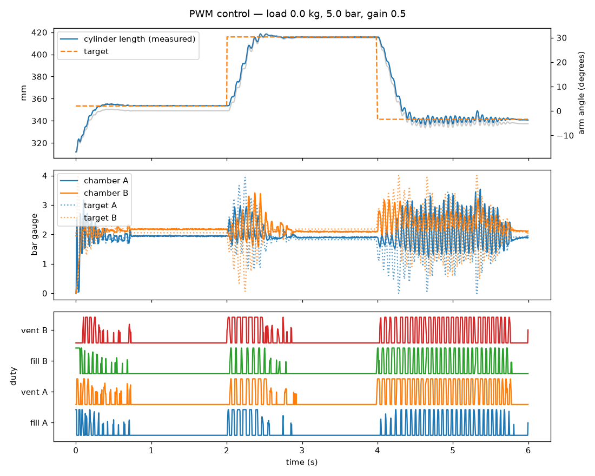
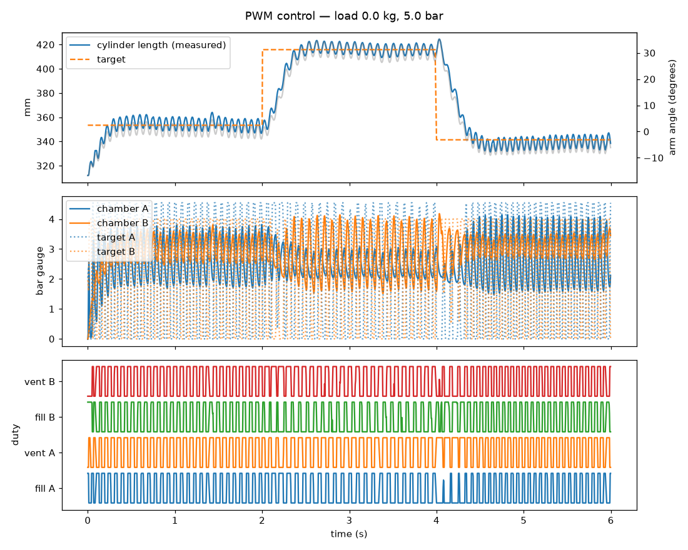
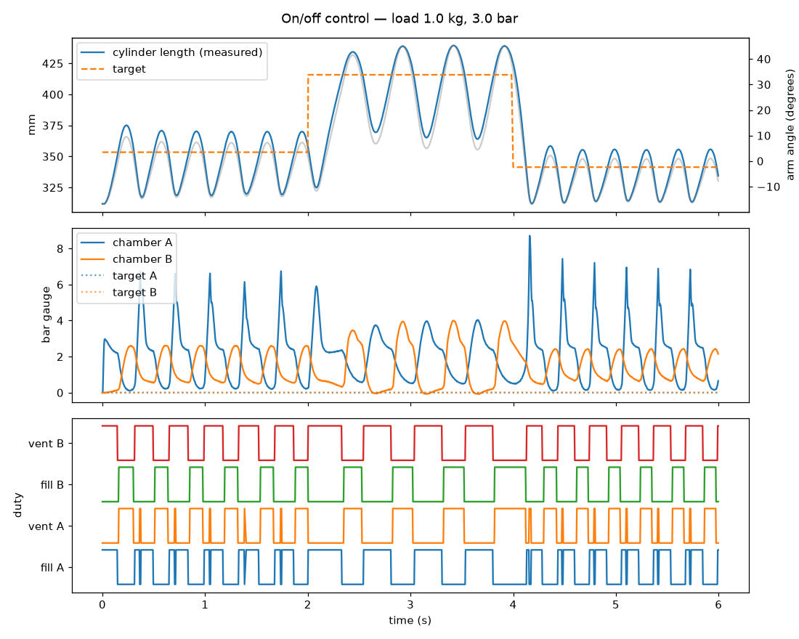
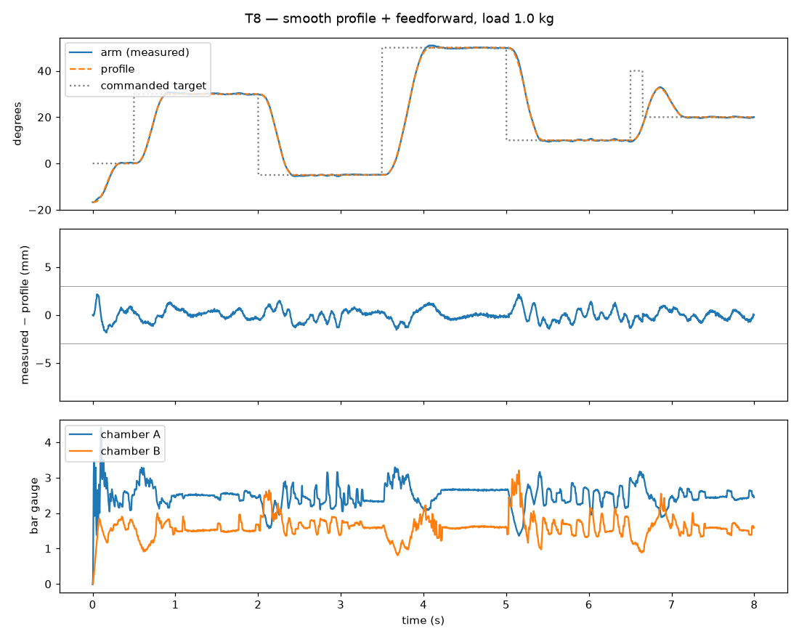
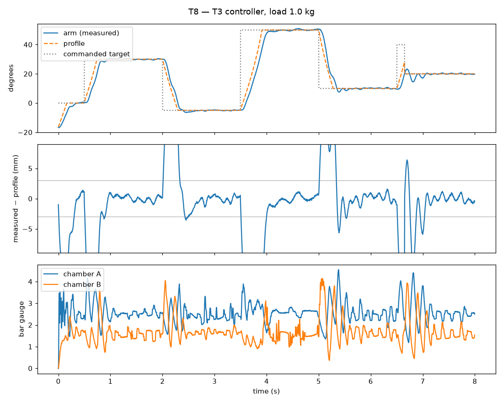

# Simulation of test 1 — results

Load 1.0 kg, supply 5.0 bar, tuning from `params.py`. T3 criteria: overshoot < 5 mm, settled (within ±1 mm) within 1 s, error < 1 mm.

## T3 PWM control and T2 on/off control

| Step | Overshoot (mm) | Settling (s) | Error (mm) | Passed |
|---|---|---|---|---|
| PWM, no load, gain 0.5: 0° → 30° | 2.74 | 0.76 | 0.15 | yes |
| PWM, no load, gain 0.5: 30° → −5° | 4.82 | 1.732 | 0.72 | no |
| PWM, no load, gain 1: 0° → 30° | 7.54 | 1.984 | 3.26 | no |
| PWM, no load, gain 1: 30° → −5° | 9.97 | 1.996 | 3.75 | no |
| PWM, 1 kg: 0° → 30° | 1.69 | 0.528 | 0.24 | yes |
| PWM, 1 kg: 30° → −5° | 3.27 | 0.596 | 0.31 | yes |
| on/off (3 bar): 0° → 30° | 23.64 | 1.984 | 24.3 | no |
| on/off (3 bar): 30° → −5° | 29.52 | 1.996 | 11.65 | no |

## T7 load ratio

| Load (kg) | Load (%) | Overshoot (mm) | Settling (s) | Error (mm) | Passed |
|---|---|---|---|---|---|
| 1.0 | 23 | 1.69 | 0.528 | 0.24 | yes |
| 2.0 | 45 | 1.19 | 0.516 | 0.38 | yes |
| 3.0 | 67 | 3.44 | 1.38 | 0.22 | no |
| 4.0 | 88 | 0.0 | 1.984 | 5.46 | no |
| 5.0 | 110 | 0.0 | 1.984 | 83.15 | no |

## T6 stiffness (valves closed, one 1 kg plate added)

| Sum of chamber pressures (bar) | Deflection (degrees) |
|---|---|
| 2.0 | 8.62 |
| 5.0 | 6.77 |

## T8 preset positions: smooth profile with feedforward

Load 1 kg (dumbbell plates bolted to the arm end), 5.0 bar. Targets 30°, -5°, 50°, 10°, 40°, 20° (the last two 0.15 s apart: a new target during a move). Criteria per move: tracking error < 3 mm, overshoot < 2 mm, within ±1.5 mm at most 0.2 s after the profile ends, mean error at rest < 1 mm. Worst case of 3 runs with different sensor noise.

| Move | Profile (s) | Tracking (mm) | Overshoot (mm) | Settled after the profile (s) | Command → settled (s) | Passed |
|---|---|---|---|---|---|---|
| → 30° | 0.404 | 1.18 | 1.34 | 0.0 | 0.404 | yes |
| → -5° | 0.432 | 1.47 | 1.32 | 0.0 | 0.432 | yes |
| → 50° | 0.584 | 1.56 | 1.18 | 0.0 | 0.584 | yes |
| → 10° | 0.452 | 2.14 | 1.46 | 0.0 | 0.452 | yes |
| → 20° | 0.672 | 1.36 | 23.69 | 0.0 | 0.672 | yes |

(one run; the last row is the new target during a move: its overshoot is past the new, nearer target and does not count)

| Controller / setting | Tracking (mm) | Overshoot (mm) | Settled after the profile (s) | New target during a move: tracking (mm) | Passed |
|---|---|---|---|---|---|
| profile 170°/s, 1550°/s² (params.py) | 2.44 | 1.67 | 0.028 | 1.36 | yes |
| 1.1× as fast (187°/s, 1876°/s²) | 3.31 | 3.06 | 0.364 | 2.18 | no |
| 1.15× as fast (195°/s, 2050°/s²) | 3.54 | 3.91 | 0.184 | 2.02 | no |
| 1.3× as fast (221°/s, 2620°/s²) | 5.44 | 5.56 | 0.248 | 2.87 | no |
| 2 kg load, same profile | 3.42 | 1.73 | 0.0 | 3.02 | no |
| 2 kg load, 10% lower speed | 2.85 | 1.46 | 0.0 | 2.02 | yes |
| 2 kg load, 20% lower speed | 1.37 | 1.21 | 0.0 | 1.61 | yes |
| load set to 0.9 kg (real 1.0 kg) | 2.12 | 1.58 | 0.024 | 1.79 | yes |
| load set to 1.1 kg (real 1.0 kg) | 1.94 | 1.63 | 0.32 | 1.33 | no |
| load set to 0.8 kg (real 1.0 kg) | 3.21 | 1.89 | 0.024 | 1.41 | no |
| load set to 1.2 kg (real 1.0 kg) | 2.73 | 2.92 | 0.32 | 1.27 | no |
| T3 controller (ramp 250 mm/s, no feedforward) | 19.75 | 6.06 | 1.04 | 18.75 | no |

